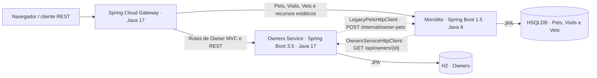

# TCC II · Spring PetClinic Legacy

A **V3** é a implementação atual deste estudo de migração incremental por Strangler Fig. O projeto parte do Spring PetClinic histórico de 2017. O Owners Service assumiu o cadastro de proprietários, a API REST e as páginas HTML de Owner. O monólito continua responsável por Pets, Visits, Vets e pelos recursos estáticos da interface.

## Arquitetura



As setas tracejadas mostram chamadas HTTP iniciadas pelas aplicações. As setas contínuas que saem do Gateway mostram o roteamento público.

| Componente | Papel | Porta interna |
| --- | --- | ---: |
| [Monólito](projects/monolith/) | Formulários e persistência de Pets e Visits, Vets, recursos estáticos e projeção interna de Pets e Visits. | 8080 |
| [Owners Service](projects/owners-service/) | API REST, páginas Thymeleaf, validação e persistência de Owner. | 8082 |
| [Gateway](projects/gateway/) | Entrada pública. Encaminha as rotas de Owner ao microsserviço e as demais rotas da aplicação ao monólito. Bloqueia `/internal/**`. | 8081 |

O `OwnerController` atende tanto `/owners` e suas páginas quanto `/api/owners`. Para renderizar o detalhe ou uma lista com vários proprietários, ele pede ao `LegacyPetsHttpClient` a projeção de Pets e Visits. Os formulários legados de Pet e Visit usam `OwnersServiceHttpClient` para obter o proprietário. A API REST e as gravações de Owner acessam o H2 pelo repositório JPA local.

## Executar

Use Docker com contêineres Linux e o plugin Compose. Na raiz do repositório, execute:

```sh
docker compose -p tcc2-v3 up --build --wait
```

Abra o [PetClinic](http://localhost:8081) ou consulte a [API de Owners](http://localhost:8081/api/owners). O Gateway é o único serviço com porta publicada no host. Defina `GATEWAY_PORT` para usar outra porta. Os bancos são provisionados em volumes próprios na primeira inicialização.

```sh
docker compose -p tcc2-v3 ps
docker compose -p tcc2-v3 down
```

O comando `down` preserva os volumes. O guia cobre importação de dados, operação e o cenário opcional com duas réplicas de Owners. [Guia Docker](DOCKER.md).

## Testar

O build Docker executa as suítes Maven ao compilar as imagens. Para rodá-las localmente, use PowerShell 7, configure `JAVA8_HOME` e `JAVA17_HOME` e aponte `MAVEN_HOME` ou o `PATH` para o Maven 3.9.11. O monólito usa seu Wrapper 3.3.3.

```powershell
./scripts/build.ps1
```

Use `-Offline` com o cache Maven completo e `-SkipGitMetadata` se a geração de metadados Git do monólito falhar em um worktree. A aceitação requer Python 3 e usa um projeto Compose descartável, pois grava registros e reinicia serviços. [Procedimento de aceitação HTTP](DOCKER.md#verificação-funcional).

## Estrutura do repositório

| Caminho | Conteúdo |
| --- | --- |
| `projects/monolith/` | Aplicação legada. O pacote `org.springframework.samples.petclinic.integration` contém `OwnersServiceHttpClient` e `IntegrationErrorHandler`. |
| `projects/owners-service/` | Entrada `br.edu.tcc.OwnersApplication`. O pacote `br.edu.tcc.owners` contém o controller unificado, a entidade e o repositório JPA. O pacote `br.edu.tcc.integration` contém `LegacyPetsHttpClient`. |
| `projects/gateway/` | Rotas públicas e filtro de disponibilidade do Owners Service. |
| `docker/` e `compose.yaml` | Imagens, redes, provisionamento e persistência. |
| `scripts/` | Build, aceitação, migração offline e coleta CK. |
| `docs/historico/` e `historico/` | Documentação da V3, evidências de validação e campanhas anteriores. |

## Resultados e escopo

A análise CK mede a estrutura dos fontes Java de produção. Os CSVs distinguem o monólito original, o monólito remanescente, o Owners Service e o Gateway. A unificação concentra métodos e dependências no controller, enquanto a remoção de tipos altera a composição das médias. [Arquitetura final, validação e métricas](docs/metricas/README.md).

O ambiente tem finalidade acadêmica. A migração pressupõe a coexistência das aplicações e as páginas compostas e formulários legados dependem de chamadas HTTP entre elas. Os cenários de indisponibilidade registram quais fluxos ficam acessíveis durante a interrupção de cada serviço.

A baseline é o commit `c36452a2c34443ae26b4ecbba4f149906af14717` da linha `1.5.x`, identificado pela tag `tcc2-baseline-2017`. O Spring PetClinic original usa a licença Apache 2.0. [Projeto original](https://github.com/spring-projects/spring-petclinic) · [README histórico e créditos](historico/documentacao/README-original-2017.md) · [Licença](https://www.apache.org/licenses/LICENSE-2.0).
