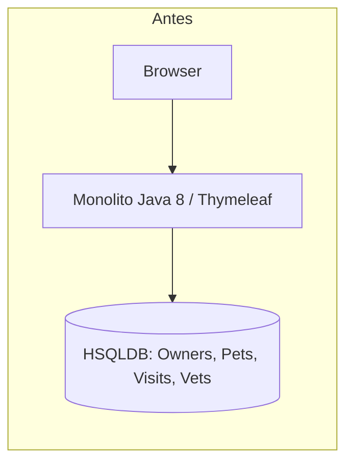
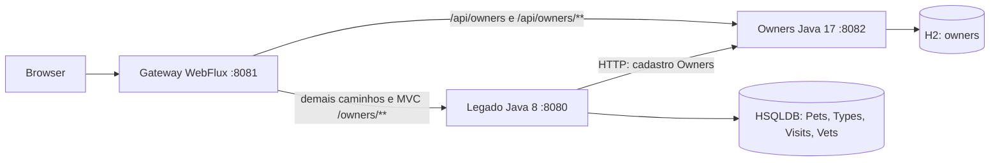

# V2 — extração exclusiva de Owners

## Objetivo e fronteira

Esta versão atende à revisão da fronteira do experimento: extrair somente Owners evita atribuir à mesma intervenção a remoção de duas responsabilidades de negócio. A baseline é o commit `c36452a2c34443ae26b4ecbba4f149906af14717`, tip `1.5.x`; a implementação anterior consultada foi `a3e74c1`. Nenhuma dessas branches foi alterada. Não foram restaurados experimentos antigos C/D. A letra C nas tabelas significa apenas o conjunto de fontes Owners.

Antes, `Owner` era uma entidade JPA que agregava `Pet`; `Pet.owner` era uma associação many-to-one e `pets.owner_id` referenciava `owners.id` no mesmo HSQLDB. `OwnerRepository` consultava cadastro e Pets por join fetch. Os controllers MVC recebiam essas entidades para renderizar Thymeleaf.

Depois, somente o cadastro de Owner possui persistência no H2. Pets, PetTypes, Visits, Vets e suas regras/repositórios continuam no legado. Os pacotes históricos foram mantidos: estar em `owner/` não significa ter sido migrado. As validações dos formulários legados são de apresentação; a API Owners valida e persiste o cadastro autoritativo.





## Mapa de implementação

Todos os caminhos abaixo são relativos à raiz. A lista de todas as fontes avaliadas com hashes está em `docs/metricas/historico/2026-10-28-v2-extracao-5b6a3b1/fontes-avaliadas.json`.

| Arquivo/classe | Papel efetivo na V2 |
| --- | --- |
| `owners-service/.../Owner.java` | Única entidade de negócio do microsserviço: id, nome, endereço, cidade, telefone; validação cadastral |
| `owners-service/.../OwnerRepository.java` | JPA Owners; pesquisa por prefixo sem distinção de caixa |
| `owners-service/.../OwnerController.java` | REST: pesquisa, detalhe, criação, atualização; exclusão bloqueada |
| `owners-service/.../OwnersApplication.java` | Bootstrap Boot 3.5.16; infraestrutura, não negócio extraído |
| `src/.../owner/Owner.java` | Representação transiente para MVC; não é entidade JPA e não é persistida |
| `src/.../owner/OwnerRepository.java` | Classe substituída por adaptador HTTP e composição de Pets locais, conservando o nome para reduzir alterações nos consumidores |
| `src/.../integration/OwnersClient.java` | Fronteira HTTP, apenas campos cadastrais, encoding da pesquisa, connect timeout 1,5 s/read timeout 3 s |
| `src/.../integration/IntegrationErrorHandler.java` | Resposta MVC 503 com página amigável |
| `src/.../integration/OwnersUnavailableException.java` | Falha de rede, timeout, servidor ou JSON inválido |
| `src/.../integration/OwnerNotFoundException.java` | 404 para Owner ausente ou Pet fora do vínculo da URL |
| `src/.../integration/OwnerValidationException.java` | 400 de validação remota |
| `src/.../system/LegacyDatabaseInitializer.java` | Primeira carga HSQLDB e gravação sem atraso; nunca limpa um banco existente |
| `scripts/MigrateOwners.java` | Ferramenta offline de migração, fora das fontes Java de produção medidas |

`src/...` significa `src/main/java/org/springframework/samples/petclinic/...`; `owners-service/...` significa `owners-service/src/main/java/br/edu/tcc/owners/...`.

No legado, `Pet`, `PetRepository`, `PetController` e `VisitController` foram adaptados para o identificador remoto, composição e validação de vínculo. `OwnerController` continua MVC e usa o contrato adaptado de `OwnerRepository`, sem alteração do seu código. `PetType`, `PetTypeFormatter`, `PetValidator`, `Visit`, `VisitRepository`, as classes `vet/`, os modelos compartilhados e demais controllers permanecem locais. A tabela 2 do relatório distingue arquivos mantidos, modificados e classes de mesmo nome com outro papel. `Person`/`BaseEntity` não foram migradas: apenas seus campos relevantes foram representados na entidade independente Owner.

Os templates foram preservados, com correção do histórico de visitas em `pets/createOrUpdateVisitForm.html`; a condição original suprimia visitas anteriores no formulário de uma nova visita. `ownersUnavailable.html` é a única página nova.

## Fluxos e integridade

**Detalhe de Owner:** Browser → Gateway → MVC legado → `OwnerRepository` → uma consulta HTTP ao Owners → consulta JPA `findByOwnerId` no legado → composição da representação Owner com Pets e Visits → Thymeleaf. Pesquisa usa uma chamada HTTP para a coleção; os Pets necessários à listagem são consultados localmente por proprietário, sem uma chamada HTTP adicional por registro.

**Cadastrar Pet:** Gateway recebe POST `/owners/{ownerId}/pets/new`; `@ModelAttribute owner` busca o Owner remoto e compõe os Pets para validar nome duplicado. Somente após Owner existir e o formulário ser válido, o legado grava Pet no HSQLDB com `owner_id`. PetType é resolvido pelo repositório local. A API Owners não recebe nem grava Pet. Se Owners não responder, não há gravação de Pet e a página retorna 503. O redirecionamento mantém o acesso por 8081; o filtro `PreserveHostHeader` foi conservado nas duas rotas.

**Atualizar Pet/registrar Visit:** o legado verifica se o `owner_id` persistido corresponde ao proprietário da URL e responde 404 quando diverge. Os campos permitidos no binding de Pet são nome, data de nascimento e tipo; em Visit, data e descrição. IDs e vínculos vêm da URL e do banco, impedindo manipulação de `id`, `ownerId` ou `petId` por parâmetros do formulário. Visits permanecem com FK local para Pet, e Pets com FK local para PetType.

**Exclusão:** DELETE de Owner existente retorna 409 para TODOS os proprietários, mesmo sem Pets; inexistente retorna 404. A interface original não oferecia exclusão. A política conservadora evita órfãos e a corrida entre verificar filhos e excluir o pai em dois bancos. Não há callback Owners → legado, dependência circular nem cache cadastral que aceite gravação durante falha. IDs não são reutilizados pela API. Exclusão futura exigiria um protocolo adicional; não foi implementada.

O monólito não possui tabela Owners na V2. `pets.owner_id` é obrigatório e mapeado por JPA como campo escalar, sem FK entre bancos. O vínculo remoto é garantido pelos fluxos da aplicação e pela política sem exclusão. Escrita SQL manual fora dessas regras não é protegida por uma FK distribuída.

## Bancos e primeira carga

Execute as três aplicações a partir da raiz conforme o README. O legado usa `jdbc:hsqldb:file:./data/v2/petclinic;shutdown=true`; Owners usa `jdbc:h2:file:./data/owners-v2;DB_CLOSE_ON_EXIT=FALSE;WRITE_DELAY=0`. A primeira carga reproduz os 10 Owners, 13 Pets e 4 Visits históricos, mantendo identificadores. `seed_history` no H2 é um marcador técnico de carga, não outro módulo de negócio. Depois da primeira carga, nenhum cadastro é sobrescrito em reinicialização. O banco legado conserva dados históricos de Vets/Types/Visits/Pets e não carrega Owners.

Foi observada perda das últimas gravações no primeiro teste de término abrupto com a configuração de atraso padrão. A V2 passou a executar `SET FILES WRITE DELAY 0` no HSQLDB e `WRITE_DELAY=0` no H2. O teste completo passou após esse ajuste. Trata-se de observação local, não garantia de durabilidade contra qualquer falha de hardware.

`LEGACY_DB_URL`, `OWNERS_DB_URL` e `OWNERS_URL` permitem caminhos/endereços externos. Os defaults não abrem os bancos da versão anterior; não renomeie um banco antigo para simular uma migração. O suporte MySQL permanece apenas como artefato histórico, fora do escopo operacional V2.

## Migração offline reproduzível

Para migrar um HSQLDB ORIGINAL que ainda contém Owners, pare as aplicações, faça uma cópia de segurança e use um diretório de destino que ainda não exista:

```powershell
$env:JAVA17_HOME = 'C:\Program Files\Java\jdk-17'
./scripts/migrate-owners.ps1 -SourceDb 'C:\copia\petclinic' -NewTargetDirectory 'C:\nova-base-v2'
# SourceDb é o caminho-base, sem .properties/.script.
# Depois, no terminal do legado:
$env:LEGACY_DB_URL = 'jdbc:hsqldb:file:C:/nova-base-v2/petclinic;shutdown=true'
# No terminal de Owners:
$env:OWNERS_DB_URL = 'jdbc:h2:file:C:/nova-base-v2/owners;DB_CLOSE_ON_EXIT=FALSE;WRITE_DELAY=0'
```

A origem é aberta com `readonly=true;files_readonly=true;ifexists=true`. A ferramenta verifica Owners órfãos, copia Owners ao H2 e os outros registros ao novo HSQLDB, conserva IDs, ajusta sequências e marca a carga como realizada. Recusa destino já existente. `migration-complete.txt` só é criado após sucesso. A migração não é transacional entre dois bancos: em falha, a origem permanece íntegra e o destino parcial deve ser inspecionado; repita em OUTRO destino novo. A ferramenta atende uma base da baseline original, não faz importação automática do H2 Owners/Pets da implementação B anterior.

O teste `python scripts/test-migration.py` constrói uma origem original sintética com um Owner/Pet/Visit adicional no ID 101, migra, verifica ausência de tabela Owners local, vínculo 101, alocação do próximo Owner 102, recusa de repetição e igualdade SHA-256 de todos os arquivos da origem. Nenhum banco real existente foi alterado para validar esse mecanismo.

## Build, testes e coleta

Comandos completos de inicialização estão no README; `scripts/build.ps1` executa clean/package e as suítes com o JDK de cada componente. Alternativa explícita, na raiz:

```powershell
$mvn = 'C:\TCC2\ferramentas\apache-maven-3.9.11\bin\mvn.cmd'
$env:JAVA_HOME = 'C:\Program Files\Eclipse Adoptium\jdk-8.0.504.1-hotspot'
& $mvn -o -B clean package '-Dcobertura.skip=true'
$env:JAVA_HOME = 'C:\Program Files\Java\jdk-17'
& $mvn -o -B -f owners-service/pom.xml clean package
& $mvn -o -B -f gateway/pom.xml clean package
python scripts/acceptance.py
python scripts/test-migration.py
./scripts/collect-ck.ps1 -CkJar 'C:\TCC2\ferramentas\ck\target\ck-0.7.1-SNAPSHOT-jar-with-dependencies.jar' -Java17Home $env:JAVA_HOME
```

`-o` depende do cache Maven; remova-o em outra máquina para baixar dependências. Cobertura não foi medida; o plugin Cobertura histórico não integra a evidência de cobertura. O build manteve Boot e Java originais. Os testes unitários não dependem de uma API Owners externa; usam mocks na fronteira, HSQLDB em memória ou H2 isolado. O teste integrado usa JVMs reais e bancos em arquivos novos e recusa portas já ocupadas.

| Suíte | Passaram | Falhas | Erros | Ignorados | Contabilizados |
| --- | ---: | ---: | ---: | ---: | ---: |
| Legado | 46 | 0 | 0 | 1 | 47 |
| Owners | 6 | 0 | 0 | 0 | 6 |
| Gateway | 1 | 0 | 0 | 0 | 1 |

O teste ignorado `CrashControllerTests` já tinha `@Ignore` na baseline. Três testes de persistência Owners foram transferidos/substituídos pelos testes REST com H2: prefixo, criação e atualização. As verificações de Pets/Visits/Vets historicamente válidas foram conservadas e adaptadas à fronteira remota; há testes adicionais de vínculo, encoding, 400/404/5xx, timeout, corpo inválido e campos enviados. As contagens são casos contabilizados pelo Surefire, não cobertura.

A aceitação registrou 57 respostas HTTP bem-sucedidas em suas expectativas, incluindo sondagens de prontidão; esse número não é uma nova contagem JUnit. Verificou pesquisa/listagem, todos os formulários, criação/edição de Owner e Pet, visitas e histórico, redirecionamentos sem 8080, recusa de vínculos inválidos e de ID injetado, persistência após reiniciar as duas JVMs de dados, exclusão 409, 503 no MVC e Vets/home acessíveis durante falha, seguido de recuperação. A verificação Thymeleaf ocorreu por renderização HTTP e conteúdo HTML, sem automação visual de browser. A primeira falha e o diagnóstico de write delay foram preservados em `evidencias/tentativas/`.

Os testes foram executados no Windows com JDK 8u504, JDK 17.0.12 e Maven 3.9.11. O sandbox inicialmente impediu loopback e instrumentação local da JVM; as execuções finais usaram permissões para esses recursos. Não há etapa funcional requerida declarada como aprovada sem execução.

## Métricas e interpretação

As cinco tabelas, CSVs brutos class/method, estatísticas e análise estão em [docs/metricas/historico/2026-10-28-v2-extracao-5b6a3b1/relatorio.md](../metricas/historico/2026-10-28-v2-extracao-5b6a3b1/relatorio.md). A baseline histórica não foi sobrescrita. A recoleta da baseline coincidiu em TODOS os campos do CK, exceto caminhos absolutos, usando o JAR local CK 0.7.1-SNAPSHOT (SHA-256 e commit do fonte registrados em `proveniencia.json`). A branch anterior não possuía script/comando de coleta versionado; a equivalência observada permite documentar os parâmetros reconstruídos, sem inventar evidência histórica de execução.

A coleta inclui fontes de produção de cada componente separadamente e todos os tipos reportados pelo CK. A baseline tem 24 tipos, o legado adaptado 30, Owners 4 e Gateway 1. Classes de integração são custos da separação e não são confundidas com funcionalidade extraída. As médias apresentam mudanças em direções diferentes; não se conclui melhoria global a partir delas. Somatórios descritivos não são uma métrica global de qualidade. Metadados e hashes identificam as fontes medidas no checkpoint de implementação.

## Limitações e decisões

Sem autenticação, TLS, circuit breaker, retries ou operações distribuídas de exclusão; são limites do experimento local. O Gateway conserva seu comportamento nativo de erro para API direta sem backend (a garantia MVC dependente é 503). Timeouts controlam espera por tentativa, sem prometer prazo global sob todos os cenários de rede. O legado requer disponibilidade de Owners nas funções dependentes e não mantém uma segunda persistência ativa de cadastro.

A pesquisa com múltiplos proprietários consulta Pets localmente por proprietário; não foi implementada otimização em lote nem avaliado desempenho/carga. A migração offline foi validada com dados sintéticos representativos da baseline, não com toda variante possível de banco legado. A primeira carga e a migração exigem inicialização por uma única instância; não existe coordenação de múltiplas instâncias de bootstrap. Escritas diretas nos bancos estão fora das garantias dos endpoints. As métricas CK não capturam os custos de comunicação distribuída nem sustentam causalidade sobre qualidade.
