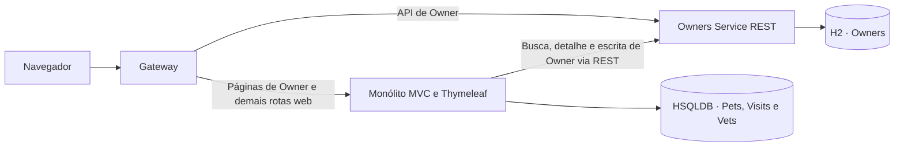
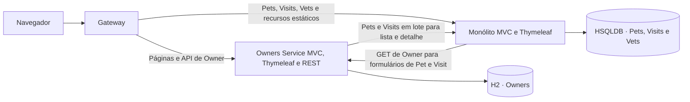

# TCC II · Migração da interface web de Owner na V3

> Registro histórico da V3 inicial. Consulte a [documentação da V3 final](README.md) para a arquitetura e as métricas atuais.

A branch `tcc2-strangler-fig-v3` deriva da V2 em `307649d`. Na V2, o Owners Service já era dono do cadastro e da API REST. O monólito atendia o MVC de Owner, consultava o serviço e agregava Pets e Visits antes de renderizar o HTML. Na V3, o Owners Service atende o MVC e persiste Owner no H2. O monólito continua responsável pelo HSQLDB, pelos fluxos de Pets e Visits, pelos veterinários e pelos recursos estáticos usados na navegação.

## Arquitetura V2



## Arquitetura V3



| Rota vista pelo navegador | V2 | V3 |
| --- | --- | --- |
| `GET /owners`, `GET /owners/find` | Monólito | Owners Service |
| `GET /owners/{id}` | Monólito | Owners Service |
| `GET/POST /owners/new`, `GET/POST /owners/{id}/edit` | Monólito | Owners Service |
| `/api/owners` e subcaminhos | Owners Service | Owners Service |
| `/owners/{id}/pets/new`, `/owners/{id}/pets/{petId}/edit` | Monólito | Monólito |
| `/owners/{id}/pets/{petId}/visits/new` | Monólito | Monólito |
| `/vets.html`, `/vets.json`, `/vets.xml`, `/`, recursos estáticos e demais rotas | Monólito | Monólito |
| `/internal/**` | Sem API correspondente | HTTP 404 no Gateway |

## Fluxo de navegação e fronteiras

Na V2, um cadastro pelo navegador passava pelo Gateway e pelo MVC do monólito. O adaptador convertia os campos em uma requisição REST ao Owners Service e devolvia o ID para o redirecionamento. Na V3, o MVC valida e grava diretamente pelo repositório do Owners Service. A pesquisa por prefixo também usa esse repositório. Zero resultados voltam ao formulário com uma mensagem. Um resultado redireciona para o detalhe. Vários resultados renderizam a lista com os nomes dos Pets.

A listagem e o detalhe enviam os IDs dos Owners em um único `POST /internal/owner-pets` de leitura. O monólito consulta os Pets e suas Visits pelo `owner_id` e retorna uma projeção agrupada por Owner. O contrato inclui ID, nome, tipo e data de nascimento do Pet, além de data e descrição de cada visita. A lista exibe apenas os nomes dos Pets e usa o mesmo contrato do detalhe. O Gateway bloqueia o prefixo interno e marca as requisições encaminhadas ao monólito para que esse endpoint rejeite também caminhos que mudem durante a normalização pelo servlet.

Nos formulários de Pets e Visits, o monólito consulta `GET /api/owners/{id}` para obter o proprietário e seus dados de exibição. A verificação de vínculo e a prevenção de nomes de Pets duplicados usam o banco legado. Cada fluxo faz uma chamada em apenas uma direção e o destino atende com dados locais. Há dependência em duas direções entre os serviços, sem chamadas de retorno na mesma requisição ou transação distribuída. O Compose inicia cada aplicação com seu próprio banco. O Gateway publica o endereço comum quando ambas estão saudáveis.

O Gateway encaminha apenas os caminhos de Owner enumerados na configuração, com precedência sobre a rota genérica. Os links para formulário, detalhe, Pets, Visits, CSS e navegação apontam para o endereço público. A API REST de Owner e a política de impedir exclusões preservam o vínculo de Pets existentes.

## Código e operação

| Componente | Mudanças principais |
| --- | --- |
| Owners Service | `OwnerWebController` implementa o MVC com validação. `LegacyPetsClient` consome a projeção com limites de conexão e leitura. `OwnersApplication` preserva as URLs MVC com barra final. O módulo incorpora Thymeleaf, os quatro templates de Owner e os dois fragmentos de que dependem. |
| Monólito | Sai o `OwnerController` MVC e saem os templates exclusivos de Owner. `OwnerIntegrationAdapter` e `OwnerRepository` ficam restritos à consulta por ID. `PetController` carrega os Pets locais na validação de duplicidade. `OwnerPetsController` e `PetRepository` expõem a leitura interna. |
| Gateway | As rotas REST e MVC de Owner precedem a rota genérica. `OwnersAvailabilityGatewayFilterFactory` converte falhas de transporte de Owners em HTTP 503. O roteamento e o bloqueio interno ficam em `application.properties`. |
| Compose | `MONOLITH_URL` aponta para o endereço interno do monólito. Cada aplicação depende inicialmente do próprio banco. As imagens V3 têm tags próprias, com os mesmos serviços, redes de dados e esquemas persistentes. |

Execute com um nome de projeto e uma porta próprios para comparar com a V2. O procedimento de importação dos bancos, o complemento de réplicas e as opções de execução estão no [guia Docker](../../DOCKER.md).

## Validação funcional

O build Docker executou as três suítes Maven. O monólito passou em 48 testes e manteve um teste histórico de erro ignorado. Os dez testes do Owners Service e o teste de rotas do Gateway passaram. A suíte de Owner verificou renderização, vínculo com a rota legada, validação, persistência e isolamento do acesso a Pets quando o monólito está indisponível.

A aceitação passou em 79 requisições pelo Gateway na porta 18083, em um projeto Compose separado. O roteiro verificou o conteúdo dos resultados de busca, as mensagens de validação, os links e os redirecionamentos, além de cadastrar e editar Owner e Pet e registrar uma Visit. Requisições a Pets de outro proprietário retornaram 404. A API REST respondeu com os dados gravados pela interface e manteve o bloqueio de exclusão. O teste confirmou a persistência após parar e iniciar os cinco contêineres com os mesmos volumes. A interrupção de cada aplicação verificou os fluxos que devolvem 503, os que continuam disponíveis e a recuperação. [Evidência HTTP](evidencias/http-compose.json).

Com duas réplicas e HAProxy, a API respondeu pelos dois slots. O detalhe de Owner mostrou o Pet e a Visit persistidos, e o formulário legado de Pet recuperou o Owner pelo balanceador. [Evidência com duas réplicas](evidencias/http-replicas.json).

O teste da migração offline, em uma fixture da baseline, confirmou IDs, vínculos Owner–Pet–Visit, sequência de identidade e recusa de sobrescrever o destino. O SHA-256 dos arquivos de origem foi conferido antes e depois. [Evidência da migração](evidencias/migracao.json).

Na raiz da V3, com Docker Compose e Python, use um projeto descartável para repetir a aceitação.

```powershell
$env:GATEWAY_PORT = '18083'
$env:TCC2_COMPOSE_PROJECT = 'tcc2-v3-validacao'
docker compose -p $env:TCC2_COMPOSE_PROJECT up --build --wait
python scripts/acceptance.py
```

## Limites da comparação

A V2 centraliza a renderização e os recursos da interface no monólito, com uma direção de integração HTTP. A V3 dá ao Owners Service controle sobre formulário, validação, persistência e renderização do cadastro. A apresentação de Pets e Visits exige uma consulta ao legado, e o layout e o fragmento de formulário passam a existir nos dois componentes. A V3 mantém a identidade visual pela rota de recursos estáticos do monólito.

Quando o Owners Service cai, as páginas e a API de Owner ficam indisponíveis. Os fluxos legados que precisam consultar Owner também retornam HTTP 503. Home e Vets continuam acessíveis. Quando o monólito cai, os detalhes e listagens com Pets retornam HTTP 503. A pesquisa inicial, os formulários de Owner e a API REST continuam respondendo, embora os recursos estáticos e os destinos legados fiquem indisponíveis.

A V3 extrai uma parte maior da funcionalidade de Owner porque transfere também a decisão e a renderização do MVC para o serviço que mantém o cadastro. A consulta a Pets e Visits continua atravessando uma fronteira HTTP. As métricas CK medem a estrutura dos tipos Java e não capturam os templates, as rotas declarativas ou a latência dessa integração.

## Métricas CK

A coleta usou o JAR CK `0.7.1-SNAPSHOT`, Java 17.0.12 e os parâmetros históricos `false 0 false`. O coletor exportou os fontes Java de produção com `git archive`. A recoleta de A, B e C reproduziu todos os campos das tabelas históricas de tipos e métodos, descontados os caminhos dos arquivos e a ordem das linhas. A [proveniência](metricas/proveniencia.json) registra revisões, versões e hashes. Os CSVs da V3 usam caminhos relativos ao repositório, UTF-8 e ordenação estável.

| Cenário | Tipos CK | Métodos CK | CBO médio | WMC médio | RFC médio | LCOM médio | LCOM* médio |
| --- | ---: | ---: | ---: | ---: | ---: | ---: | ---: |
| A · Monólito original | 24 | 91 | 6,6667 | 4,9167 | 3,4583 | 5,8750 | 0,2566 |
| B · Monólito V2 Docker | 27 | 104 | 6,5556 | 5,3704 | 4,6667 | 6,0741 | 0,2426 |
| D · Monólito V3 | 29 | 96 | 6,0000 | 4,5172 | 4,3448 | 5,7241 | 0,2106 |
| C · Owners Service V2 | 4 | 20 | 8,0000 | 5,0000 | 2,7500 | 9,0000 | 0,2361 |
| E · Owners Service V3 | 9 | 33 | 6,7778 | 4,5556 | 5,3333 | 5,7778 | 0,1799 |
| F · Gateway V3 | 2 | 2 | 3,5000 | 1,0000 | 1,5000 | 0,0000 | 0,0000 |

Cada linha usa apenas os tipos do cenário. A CK conta interfaces, tipos internos, records e classes anônimas. O Owners Service V3 tem oito tipos nomeados e um tipo anônimo do cliente HTTP. Os métodos são os emitidos pela CK nos fontes analisados. O Gateway tem um tipo de inicialização e um filtro de disponibilidade. A configuração declarativa das rotas fica fora da coleta.

No monólito, a saída de `OwnerController` e a inclusão de `OwnerPetsController` com dois tipos internos explicam o aumento de 27 para 29 tipos. O RFC do adaptador cai de 24 para 6 com a retirada da busca, escrita e composição. A consulta local acrescenta duas unidades de RFC a `PetController`, e `PetRepository` sobe de 4 para 5 em WMC. Dos 26 tipos comuns entre B e D, 22 mantêm os cinco indicadores. Entre os 23 tipos presentes nos três monólitos, o WMC médio cai de 4,7826 para 4,7391 entre B e D, enquanto o RFC sobe de 3,4348 para 3,5217. Isso mostra o efeito de mudar a população ao comparar as médias do componente inteiro.

| Tipo e componente | Versão | CBO | WMC | RFC | LCOM | LCOM* |
| --- | --- | ---: | ---: | ---: | ---: | ---: |
| `OwnerController` · Monólito | A e B | 15 | 14 | 17 | 0 | 0,4444 |
| `OwnerWebController` · Owners Service | E | 17 | 15 | 22 | 15 | 0,6750 |
| `OwnerPetsController` · Monólito | D | 6 | 5 | 20 | 1 | 0,3333 |
| `LegacyPetsClient` · Owners Service | E | 9 | 5 | 12 | 0 | 0,0000 |

Os dois controllers MVC correspondem pela função na navegação. O controller V3 trabalha diretamente com JPA e agrega a projeção remota. O RFC médio de Owners Service sobe de 2,7500 para 5,3333 após a inclusão do MVC e do cliente, enquanto a população cresce de quatro para nove tipos. Os resultados descrevem a redistribuição do trabalho e incluem custos de integração nas duas aplicações.

- [Comparação por nome qualificado nos três monólitos](metricas/comparacao-monolitos.csv).
- Monólito V3 · [Tipos](metricas/D-monolito-v3/class.csv) · [Métodos](metricas/D-monolito-v3/method.csv).
- Owners Service V3 · [Tipos](metricas/E-owners-service-v3/class.csv) · [Métodos](metricas/E-owners-service-v3/method.csv).
- Gateway V3 · [Tipos](metricas/F-gateway-v3/class.csv) · [Métodos](metricas/F-gateway-v3/method.csv).
- [Coleta e metodologia históricas da V2](../metricas/README.md).

Com o JDK 17 configurado em `JAVA17_HOME` e o JAR histórico em `$ckJar`, execute o comando abaixo.

```powershell
./scripts/collect-ck.ps1 -CkJar $ckJar -V3
```

O comando usa `HEAD` para D, E e F e as revisões fixadas no coletor para A, B e C. Compare os CSVs como multiconjuntos de linhas sem a coluna `file`.
